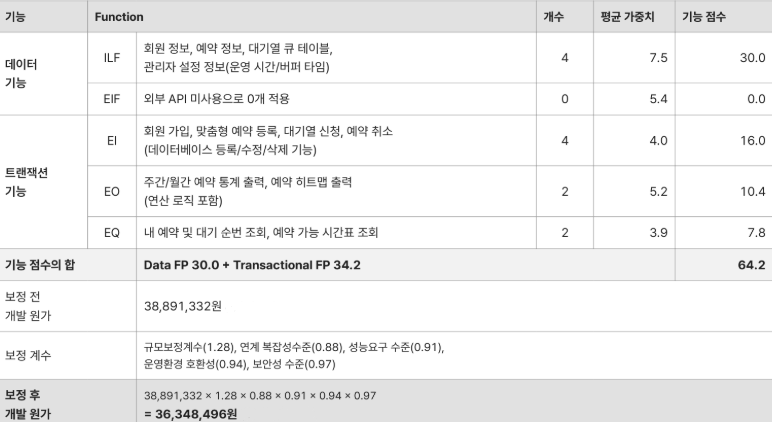

# 소프트웨어공학 과제

22211999 김두현

## 1단계: 대상 제어기 선택

- 대상 시스템: 사용자 맞춤형 예약 및 대기열 제어 시스템(Customizable Reservation & Waitlist Control System)
    - 선정 사유: 고정된 시간표를 벗어나 사용자가 원하는 시간을 지정할 수 있게 하되, 예약 취소나 변경 시 발생하는 빈 시간을 알고리즘으로 효율적으로 제어하여 시스템 자원 활용도를 높히기 위함.
    - 기획 배경 및 문제 정의: 기존의 예약 시스템은 1시간 단위 등 고정된 시간표를 제공하여 사용자의 세밀한 일정 조정이 불가능하고, 예약 취소 발생 시 빈 시간을 즉각적으로 채우기 어려워 자원의 낭비(No-show 피해 등)가 발생합니다. 이에 따라 무엇(what)을 개발할 것인지 명확히 정의하고 개발 범위(scope)를 설정하여 프로젝트의 타당성을 확보하고자.

## 2단계: 프로젝트 범위 정의

- 프로젝트 목표(Objectives): 사용자의 세밀한 예약 시간 설정을 지원하고, 취소된 예약 슬롯을 대기자에게 자동으로 할당하여 예약 부도율(no-show)의 영향을 최소화하는 자체 제어 시스템을 구축한다.
- 범위 포함 사항 및 핵심 추가 기능:
    - 맞춤형 시간 탐색 및 할당 로직: 30분, 45분 등 사용자가 원하는 단위로 가용 시간을 쪼개어 탐색하고 예약.
    - 동적 준비 시간(Buffer Time) 자동 블록: A 예약과 B 예약 사이에 관리자가 설정한 준비/청소 시간(예: 10분)을 시스템이 자동으로 계산하여 예약 불가 처리.
    - 스마트 대기열(Waitlist) 자동 할당 기능: 특정 시간이 꽉 찼을 경우 큐(Queue)에 대기시키고, 기존 예약 취소 시 대기 순번에 따라 자동으로 예약 확정 및 앱 내 알림(팝업) 처리.
    - 인기 시간대 시각화 (Heatmap): 관리자 대시보드에서 예약이 잦은 시간대를 SQL 통계 쿼리를 통해 색상별로 시각화하여 제공.
    - 동시성(Concurrency) 제어: 트랜잭션 충돌 방지를 위해 다수의 사용자가 동시간대에 예약을 시도할 경우 발생하는 데이터 정합성 문제 제어.

## 3단계: 시스템 문맥도 및 이해관계자 분석

- 시스템 문맥도(구조):
    - [중앙] 맞춤형 예약 제어 시스템
    - [외부 엔티티 1] 사용자 (예약자/대기자): 조건부 예약 요청, 대기열 등록, 예약 상태 조회
    - [외부 엔티티 2] 시스템 관리자: 가용 시간대(블록) 설정, 예약 현황 대시보드 조회
    - [외부 엔티티 3] 사내 이메일 서버 (또는 더미 SMTP): 예약 확정/취소 시 시스템 내부에서 발송되는 안내 메일
- 이해관계자  분석 (사용자 측면):
    - 예약자 (일반 사용자): 본인의 개인 일정에 맞추어 유연하게 비어있는 시간을 찾고 싶어 하며, 원하는 시간이 마감되었더라도 대기열을 통해 취소 표를 우선적으로 확보하고자 하는 니즈가 있습니다.
    - 서비스 제공자 (관리자): 빈 예약 시간을 최소화하여 운영 효율성을 높이고 싶어 합니다. 수동으로 예약 일정을 조율하거나 대기자에게 일일이 연락하는 수고를 시스템을 통해 자동화하길 원합니다.
    - 시스템 운영자 (개발자): 다중 접속 상황에서도 데이터베이스의 락(Lock)이나 데드락(Deadlock) 현상 없이 시스템이 안정적으로 트랜잭션을 처리하도록 제어해야 합니다.
- 시스템 문맥 (System Context):
    - [예약자]↔(예약 요청 / 대기열 신청 / 상태 조회) ↔ [맞춤형 예약 제어 시스템]
    - [관리자] ↔ (운영 시간 및 버퍼 타임 설정 / 예약 통계(Heatmap) 확인) ↔ [맞춤형 예약 제어 시스템]
    - *내부 시스템 동작:* 시스템은 데이터베이스 내 예약 현황을 조회·업데이트하고, 큐(Queue)를 모니터링하여 변동 사항 발생 시 내부 알고리즘을 통해 예약 상태(대기↔ 확정)를 자동 갱신합니다.

## 4단계: 제약사항 조사

- 기술적 제약 (Technical): 인기 시간대에 다수의 사용자가 동시에 예약을 시도할 때 DB의 동시성(Concurrency) 문제가 발생할 수 있으므로, 트랜잭션 격리 수준(Isolation Level)이나 락(Lock) 제어를 학부 수준에서 구현하고 테스트해야 함.
- 경제적 제약 (Economic feasibility): 학생 프로젝트 특성상 상용 서버 호스팅이나 유료 데이터베이스를 구축할 예산이 편성되어 있지 않음. 프론트엔드는 Netlify와 같은 무료 호스팅 플랫폼을 활용하고, 백엔드 및 DB는 Oracle Cloud Always Free 사용.
- 법적 제약 (Legal feasibility): 예약자의 이름, 연락처 등 개인정보를 수집하므로 지적 소유권 및 법적인 문제가 없는지 검토해야 하며, 개인정보보호법에 따른 암호화 저장 정책을 준수해야 함.

## 5단계: 프로젝트 규모 산정

- 소프트웨어의 기능적 규모를 측정하는 기능 점수(Function Point, FP) 기법을 기반으로 산정합니다. 외부 API가 없으므로 내부 논리 파일(ILF)과 트랜잭션 중심(EI, EO, EQ)으로 규모를 산출.
    
    
    

## 6단계: 주요 업무 구분 후 WBS와 연계

- 프로세스 모델 선정: Agile-Scrum model
    - 선정 사유: 대학생 프로젝트 특성 상 짧은 기간에 알고리즘 구현의 난관이나 요구 사항 변경이 빈번히 발생 가능, 따라서 폭포수 모델처럼 한번에 완벽한 설계보다는, 실시간으로 변하는 요구에 민첩하게 대응하고 실행 가능한 소프트웨어를 빠르게 확인하기 위하여.
- 계획 및 분석 (1~3 주차):
    - 요구사항 명세서 작성 및 기능 확정
    - 대기열 처리 및 동적 블록 할당 알고리즘 정책 정의
- 시스템 설계 (4~6 주차):
    - DB 구조 설계 (ERD 작성 및 정규화)
    - 시스템 아키텍처 및 클래스 다이어그램 설계
    - 화면 인터페이스(UI) 기획
- 핵심 기능 구현 (7~11 주차):
    - 회원 관리 및 기본 CRUD 구현
    - 맞춤형 시간 탐색 및 동적 버퍼 타임 제어 로직 구현
    - 큐(Queue) 기반 대기열 순번 자동 할당 로직 구현
- 테스트 및 통합 (12~15 주차):
    - 동시 예약 시나리오(동시 성 제어) 스트레스 테스트 수행
    - 시스템 통합 테스트 및 디버깅
    - 최종 결과 보고서 작성 및 기말 시연 준비
